# ARES TEAM

### Reverse Engineering · Malware Analysis · Programming · Web Development

  
  
  
  

---

## About

I'm Rayef, an 18-year-old chemistry student with a strong interest in programming and cybersecurity.

My main interests are **reverse engineering, malware analysis, OSINT, systems, and web development**.

I enjoy breaking down software, understanding how it works internally, and building practical tools around what I learn.

I'm also a co-owner of **DeadlySins**.

---

## Focus

<table>
  <tr>
    <td align="center" width="25%"><strong>RE</strong> Reverse Engineering</td>
    <td align="center" width="25%"><strong>MA</strong> Malware Analysis</td>
    <td align="center" width="25%"><strong>OS</strong> OSINT</td>
    <td align="center" width="25%"><strong>WEB</strong> Web Development</td>
  </tr>
</table>

---

## Languages

  

## Tools

  

---

## Currently Learning

  <code>C++</code> · <code>Reverse Engineering</code> · <code>Cybersecurity</code> · <code>Malware Analysis</code> 
  <code>Systems</code> · <code>Networking</code> · <code>Windows Internals</code>

---

## Activity

  <picture>
    <source media="(prefers-color-scheme: dark)" srcset="https://raw.githubusercontent.com/aresrecon/aresrecon/output/github-snake-dark.svg" />
    <source media="(prefers-color-scheme: light)" srcset="https://raw.githubusercontent.com/aresrecon/aresrecon/output/github-snake.svg" />
    
  </picture>

---

  

